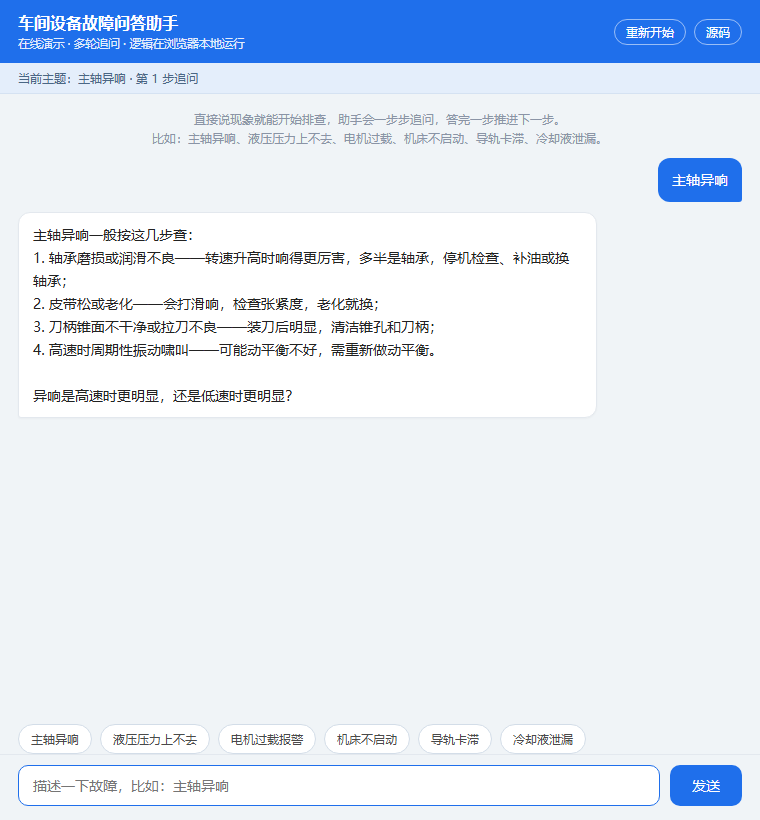

# 车间设备故障问答助手

**在线演示：<https://liu-97-coder.github.io/workshop-fault-assistant/>**（浏览器直接打开，不用装任何东西）



给车间工人用的故障排查工具：在网页里输入设备故障现象，它会给出处理步骤，还支持多轮追问。

## 在线演示

`docs/` 目录下是同一套逻辑的浏览器版：多步追问状态机、否定词识别（"没有"不会被当成"有"）、
快捷分诊都与 `qa.py` / `fault_kb.py` 一致，只是把 Python 换成了 JS，方便任何人点开就能试。

## 怎么跑（本地）

不需要装第三方库，有 Python 3 即可：

```bash
python app.py
```

启动后在本机浏览器打开 `http://localhost:8000`（本机地址，需先运行程序）就能用。

可以试着问：

- 主轴异响
- 液压压力上不去
- 电机过载报警
- 机床不启动
- 导轨卡滞
- 冷却液泄漏

## 它怎么工作

- 故障案例都放在 `fault_kb.py` 里：每个故障配了**关键词 → 处理步骤 → 追问引导**。
- `qa.py` 是问答引擎，支持**多轮**：这一轮识别出故障会记住主题，下一轮你问"那怎么办"它会结合上一轮继续聊。
- `app.py` 用 Python 自带库起网页服务，不需要 Flask。

## 想加新的故障

打开 `fault_kb.py`，照样子往 `CASES` 里加一条（关键词 + 回答 + 追问）即可，保存后重启服务。

## 目录结构

```text
workshop-fault-assistant/
├─ app.py             网页服务入口（python app.py 启动）
├─ qa.py              问答引擎（多轮逻辑）
├─ fault_kb.py        故障案例知识库（可自由增删）
├─ static/
│  └─ index.html      聊天界面
└─ docs/
   └─ index.html      在线演示页（GitHub Pages）
```
